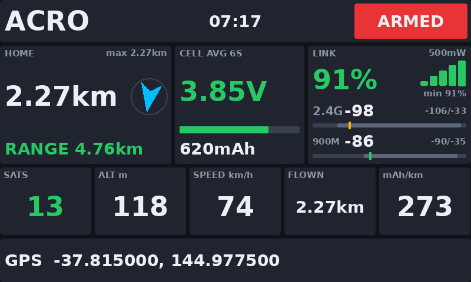
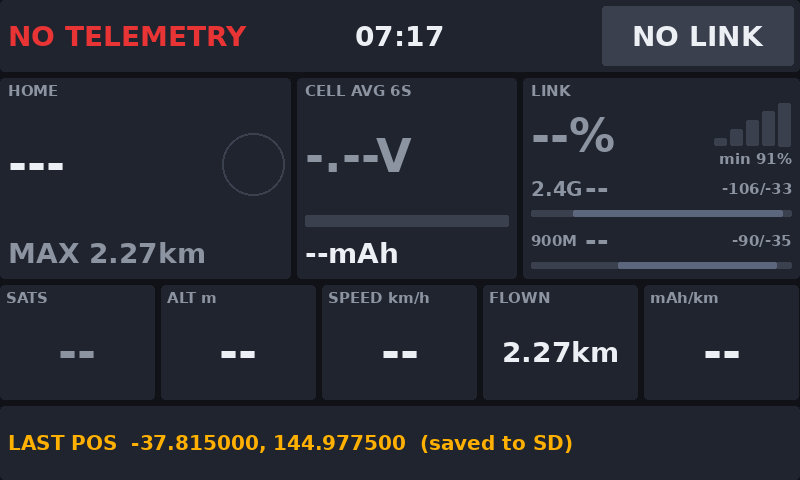
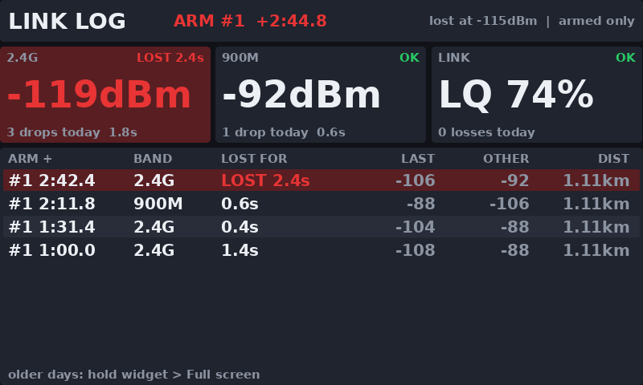
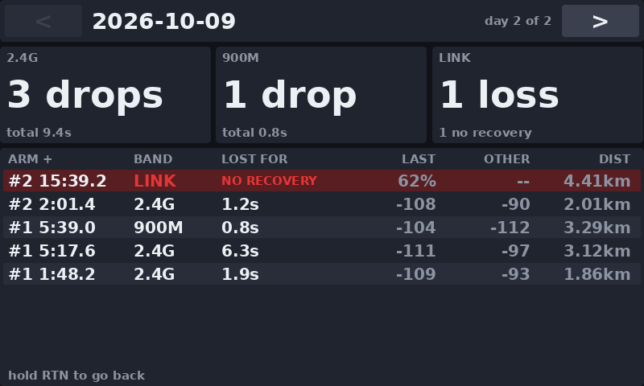
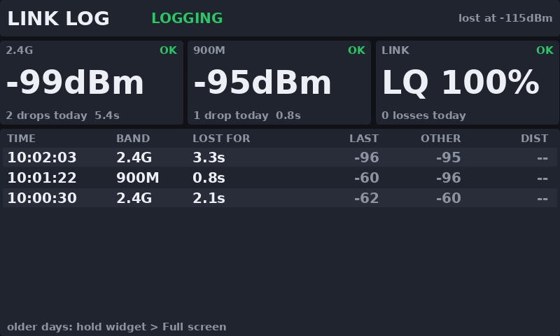
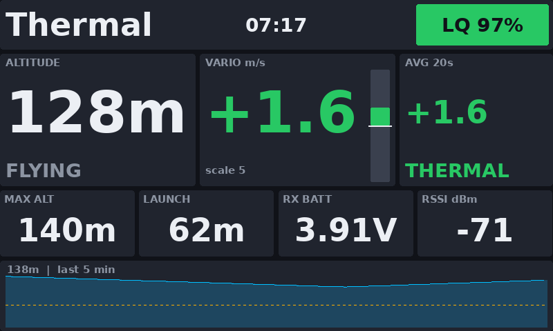

# EdgeTX FPV Widgets

Three telemetry widgets for EdgeTX colour radios, built on a RadioMaster TX16S MK3 (800×480) with an
ExpressLRS Gemini Xrossband (2.4 GHz + 900 MHz) link:

| Widget | For | What it does |
|---|---|---|
| **BFDash** | Betaflight long-range quads | Distance and arrow home, range estimate, cell voltage, link quality with 2.4 / 900 MHz dBm, GPS |
| **ELRSLog** | Any ExpressLRS model | Logs every 2.4 GHz / 900 MHz dropout and link loss to the SD card, with voice alerts |
| **GlideDash** | RC gliders | Altitude, vario, climb averager, launch height, altitude trace |

All three draw with rounded panels, size their text to fit whatever zone they're placed in, and keep
running in the background when their screen isn't showing.

> The screenshots below were rendered in a simulator from the real widget code. On the radio the
> layout and colours are the same, but EdgeTX's own fonts look slightly different.

---

## Installing

1. Connect the radio to your computer with USB and choose **USB Storage (SD)**
   (or put the SD card in a card reader).
2. Copy the **`WIDGETS`** folder from this repository onto the root of the SD card. You should end up with:
   ```
   WIDGETS/BFDash/main.lua
   WIDGETS/ELRSLog/main.lua
   WIDGETS/ELRSLog/sounds/lost24.wav, lost900.wav, back24.wav, back900.wav
   WIDGETS/GlidDash/main.lua      (shows as "GlideDash" in the widget list)
   ```
3. Restart the radio.
4. With the model powered and bound, go to **Model → Telemetry → Discover new sensors** and leave it
   running for a minute (GPS sensors may need a GPS lock before they appear).
5. Long-press **TELE** to open screen setup, add a screen with a full-screen layout (turning off the top
   bar and sliders gives more room), and pick the widget.

Screen layouts are saved per model, so add the widgets to each model you want them on.

### Telemetry ratio

The widgets can only show what the link delivers. At 100 Hz with a **1:64** telemetry ratio ELRS gets
about 31 bps back, so GPS and battery values only refresh every 10+ seconds. **1:16** (or 1:8) is
recommended for GPS long-range flying. It doesn't reduce control range, it just shares a few more time
slots with telemetry. See the [ExpressLRS telemetry bandwidth table](https://www.expresslrs.org/info/telem-bandwidth/).

---

## BFDash

Long-range dashboard for Betaflight quads.



- **Home:** distance from home (set when you arm, like Betaflight) with an arrow pointing home relative to
  your direction of travel (grey below 5 km/h, when GPS heading isn't reliable), plus max distance.
- **Range estimate:** from your mAh per km so far, keeping a 20% reserve. It turns amber, then red, and
  double-beeps when it's getting close to your distance home.
- **Battery:** average cell voltage (cell count auto-detected), fuel bar (capacity-based if you set the
  pack size), mAh used.
- **Link:** LQ with signal bars and lowest LQ, TX power, and separate **2.4 GHz and 900 MHz dBm** rows,
  each with the weakest / strongest reading of the flight and a range bar.
- **Tiles:** satellites, altitude, speed, distance flown, mAh/km.
- **Flight mode, timer and ARMED / DISARMED** across the top. Failsafe shows red, GPS Rescue amber.
- **Low battery alert:** beep and vibration when a cell drops below your threshold while armed.

When the link drops, the last GPS position stays on screen and is saved to `WIDGETS/BFDash/lastpos.txt`:



**Settings**

| Setting | Meaning |
|---|---|
| `Cells` | Cell count, 0 = auto-detect |
| `MinCell` | Low-cell warning in tenths of a volt (35 = 3.5 V) |
| `CapX100` | Pack capacity in hundreds of mAh (18 = 1800 mAh), 0 = off. Enables the range estimate |
| `Alerts` | Low battery / low range beeps |
| `Bands` | 0 = Gemini swapped, **1 = Gemini Xrossband** (900 on `1RSS`, 2.4 on `2RSS`), 2 = 2.4 GHz only, 3 = 900 MHz only |

Sensors: `RxBt Capa RQly 1RSS 2RSS TPWR FM GPS Sats Alt GSpd Hdg`

---

## ELRSLog

Works with any ExpressLRS receiver, whatever the flight controller (or none). Logs every time you lose
the 2.4 GHz or 900 MHz side of a Gemini link, or the whole link, and tells you
which by voice: *"two point four lost"*, *"nine hundred back"*.



- **Live cards** for each band and the overall link. A card turns red and counts up while that band is lost.
- **Event table:** time since arm (numbered per arm, to the tenth of a second, for lining up with DVR
  footage), band, how long it was lost, last dBm before the drop, what the *other* band was reading, and
  distance from where you started.
- **Saved as it happens:** a `LOST` row is written the moment a dropout starts and a `BACK` row when it
  recovers. A link that never comes back (crash, flyaway) is still saved, and shows as **NO RECOVERY**.
- **ArmedOnly:** nothing is logged while disarmed, so unplugging after landing isn't a "link loss".
- **Per model:** each model only sees its own events, and arm numbers carry on across restarts within a day.
- **Runs in the background**, so put it on a second screen and fly with your dashboard on the first.

**Browsing older days:** long-press the widget and choose **Full screen** (or select it and press ENTER).
Tap **<** / **>** or press the rotary to change day, turn the rotary or tap the table to scroll, and hold
**RTN** to go back.



On a plane or any model that doesn't report arming, untick **ArmedOnly**. The table then shows the clock
time instead:



**Settings**

| Setting | Meaning |
|---|---|
| `LostDBm` | A band counts as lost at or below this (default -115 dBm) |
| `Bands` | Same as BFDash: 0 swapped, **1 Gemini Xrossband**, 2 = 2.4 only, 3 = 900 only |
| `Audio` | 0 = silent, **1 = voice**, 2 = tones only (high = 2.4 GHz, low = 900 MHz) |
| `SayBack` | Also announce when a band recovers (dropouts of 1 s or more) |
| `ArmedOnly` | Only log while armed (untick for planes) |

**Log files:** `LOGS/ELRSLog-YYYY-MM-DD.csv`, one per day, shared by all models:

```
date,time,event,arm_no,since_arm,since_arm_s,flight_timer,band,lost_for_s,last_value,other_band_dbm,min_lq,armed,lat,lon,dist_from_first_fix_m,model
```

`event` is `LOST` or `BACK`. `last_value` is the band's last dBm before the drop, or the last LQ % for `LINK`.

The voice clips in `WIDGETS/ELRSLog/sounds/` are 32 kHz, 16-bit mono WAVs made with text-to-speech.
Replace them with your own recordings if you like, keeping the same file names.

Sensors: `RQly 1RSS 2RSS`, plus `FM` (arming, from Betaflight) and `GPS Sats` (position) if your model sends them

---

## GlideDash

Dashboard for RC gliders.



- **Altitude**, the biggest number, relative to where the model was when telemetry connected.
- **Vario** in m/s with a climb/sink bar gauge (uses a `VSpd` sensor if you have one, otherwise worked
  out from altitude).
- **Climb averager** over the last 20 s, with **THERMAL** / **SINK** hints.
- **Max altitude, launch height** (detected automatically at the top of the launch or motor run),
  **RX battery** and **RSSI**.
- **Altitude trace** of the last 5 minutes, with a dashed line at launch height.
- **Your radio's flight mode** (Launch / Cruise / Thermal ...) and an LQ pill across the top.

**Settings**

| Setting | Meaning |
|---|---|
| `LowRxV` | RX battery warning in tenths of a volt (35 = 3.5 V), 0 = off |
| `VarioRng` | Vario bar full scale, m/s |
| `AvgSecs` | Climb averager window, seconds |
| `Alerts` | Low RX battery beep |
| `BigText` | Off = every value one font size smaller |

Sensors: `Alt VSpd RxBt RQly 1RSS` (names can be changed at the top of `main.lua`)

Tip: for gliding, also set up EdgeTX's built-in audio vario (Special Function → **Vario**) so you can
hear climbs while watching the plane.

---

## Notes

- Written for EdgeTX colour radios and ExpressLRS (CRSF telemetry). Other receivers will work as long
  as the sensor names match.
- Betaflight sends the flight mode with a `*` when disarmed. That's how BFDash and ELRSLog detect arming.
- Telemetry loss is detected with EdgeTX's `getRSSI()`, because sensors can keep showing their last
  value after the link drops.
- EdgeTX allows widgets a maximum of five settings, which is why a few less-used options are constants
  at the top of each `main.lua` (for example `BIG_TEXT` in BFDash, `DBM_OK` / `DBM_LOW` colour thresholds).
- EdgeTX limits widget folder names to 8 characters, which is why the glider widget's folder is `GlidDash`.

## License

[MIT](LICENSE): free to use, change and share, including in your own projects. Just keep the copyright notice.
